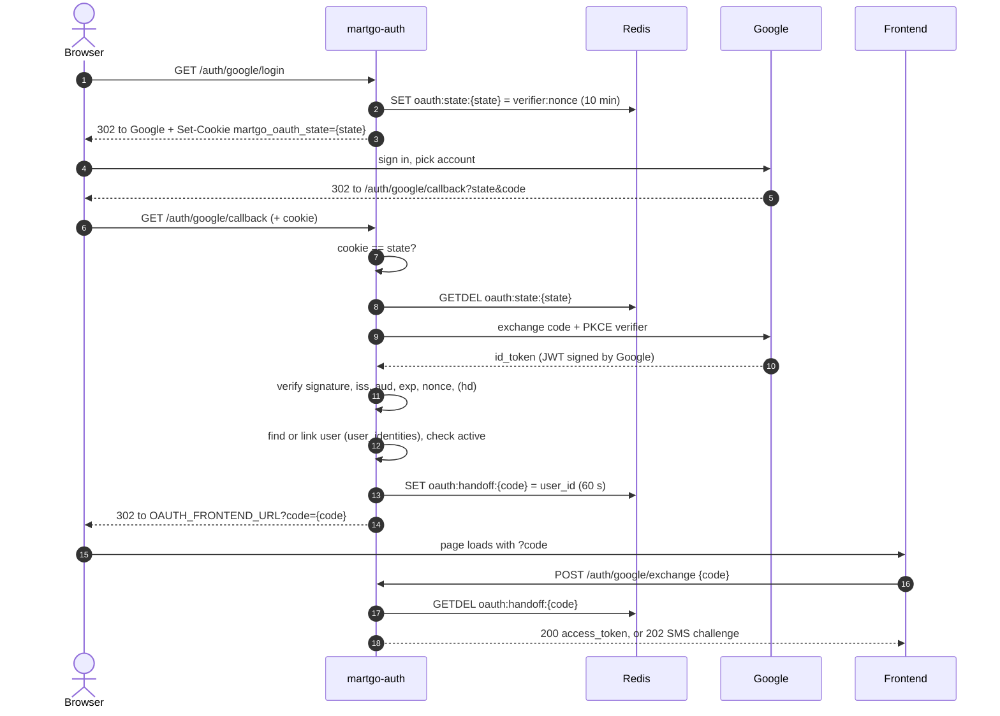

# Login with Google

Staff can sign in to martgo with their Google account instead of (or as well as)
their email and password. martgo-auth is an **OAuth2 / OpenID Connect client** of
Google here: Google only proves _who_ the person is. martgo-auth still decides
whether that person may log in, and issues its **own** JWT. mart-api cannot tell
a Google login from a password login and needs no changes.

- Only staff that an admin already created can sign in. Nobody is signed up
  automatically.
- A user with a phone still has to enter the SMS code. Google login does not skip 2FA.
- The feature is off unless `GOOGLE_CLIENT_ID` is set.

## Contents

- [How it works](#how-it-works)
- [Endpoints](#endpoints)
- [Who may log in](#who-may-log-in)
- [Security measures](#security-measures)
- [Data](#data)
- [Configuration](#configuration)
- [Code map](#code-map)
- [How to test](#how-to-test)
- [Troubleshooting](#troubleshooting)
- [Known limitations](#known-limitations)

## How it works



In words:

1. **Start.** `GET /auth/google/login` creates three random values. The **state**
   goes to Google and into an HttpOnly cookie. The **PKCE verifier** stays in Redis
   and only its SHA-256 hash goes to Google. The **nonce** goes to Google and comes
   back inside the ID token. The browser is redirected to Google.
2. **Google.** The user signs in and picks an account. Google redirects the browser
   back to `/auth/google/callback?state=...&code=...`.
3. **Callback.** martgo-auth checks that the `state` in the URL equals the cookie,
   takes the state out of Redis (single use), and exchanges the `code` for tokens,
   sending the PKCE verifier with it. It then verifies the `id_token`: Google's
   signature, issuer, audience (our client ID), expiry and our nonce.
4. **Decide.** The Google account (its `sub`) is looked up in `user_identities`.
   The first time, it is linked to the user with the same **verified** email.
   Disabled or unknown users are refused.
5. **Hand off.** Instead of putting the JWT in a URL, martgo-auth stores a one-time
   code in Redis for 60 seconds and redirects to `OAUTH_FRONTEND_URL?code=...`.
6. **Exchange.** The frontend posts the code to `/auth/google/exchange`. The user is
   reloaded (they may have been disabled meanwhile). Then the login finishes exactly
   like a password login: `202` with an SMS challenge if the user has a phone
   (finish with `POST /auth/login/verify`), otherwise `200` with the access token.

## Endpoints

All under `/api/v1`, public, rate limited to 10 requests per minute per IP each.
They exist only when `GOOGLE_CLIENT_ID` is set.

| Endpoint                     | Called by                                      | Result                                                             |
| ---------------------------- | ---------------------------------------------- | ------------------------------------------------------------------ |
| `GET /auth/google/login`     | the browser (a link or button on the frontend) | `302` to Google, sets `martgo_oauth_state` cookie                  |
| `GET /auth/google/callback`  | Google, through the browser                    | `302` to `OAUTH_FRONTEND_URL?code=...` or `?error=...`             |
| `POST /auth/google/exchange` | frontend JavaScript, body `{"code": "..."}`    | `200` like `/auth/login`, `202` SMS challenge, `400`, `401`, `429` |

Error reasons on the frontend redirect (`?error=`):

| Reason          | Meaning                                                                                                                                         |
| --------------- | ----------------------------------------------------------------------------------------------------------------------------------------------- |
| `access_denied` | The user pressed Cancel at Google (Google sent `?error=`)                                                                                       |
| `invalid_state` | Missing or different state cookie, or the state is unknown, used or older than 10 minutes                                                       |
| `not_allowed`   | No active martgo user for this Google account, email not verified, already linked to another Google account, or outside `GOOGLE_ALLOWED_DOMAIN` |
| `failed`        | Anything unexpected (Google exchange error, Redis down...). The details are logged as `google login failed` with the request ID                 |

`/auth/google/exchange` errors: `401 login link expired, please sign in again` (unknown,
used or expired code) and `401 this Google account cannot sign in to MartGo` (user
deleted or disabled since the redirect).

## Who may log in

```
Google account (sub) linked in user_identities?
├── yes → that user
└── no  → Google says email_verified?
          ├── no  → not_allowed
          └── yes → user with that email exists?
                    ├── no  → not_allowed          (no automatic sign-up)
                    └── yes → link (provider, sub) → user
                              └── user already linked to another Google account → not_allowed
then: user.is_active? no → not_allowed
```

After the first login the account is found by `sub`, not by email. If the person
later changes their Google email they can still log in, and whoever gets the old
email address cannot take over the martgo user.

## Security measures

| Measure                                                       | Where                          | Stops                                                        |
| ------------------------------------------------------------- | ------------------------------ | ------------------------------------------------------------ |
| `state` in Redis, single use (`GETDEL`), 10 min               | `oauth.Google.Start/Finish`    | forged or replayed callbacks                                 |
| `state` also in an HttpOnly, SameSite=Lax cookie              | `GoogleHandler.Login/Callback` | login CSRF (a victim finishing a login the attacker started) |
| PKCE (S256)                                                   | `oauth.Google`                 | a stolen authorization code being redeemed                   |
| `nonce` checked in the ID token                               | `oauth.Google.Finish`          | replay of an old ID token                                    |
| ID token verified (signature, `iss`, `aud`, `exp`) by go-oidc | `oauth.Google.Finish`          | forged ID tokens                                             |
| `hd` claim checked when `GOOGLE_ALLOWED_DOMAIN` is set        | `oauth.Google.Finish`          | accounts outside the company Workspace                       |
| `email_verified` required to link                             | `AuthService.linkIdentity`     | account takeover with an unverified email                    |
| No automatic sign-up                                          | `AuthService.linkIdentity`     | any Gmail user getting into the store system                 |
| One Google account per user (`UNIQUE (user_id, provider)`)    | migration `00004`              | relinking a user to a different Google account               |
| One-time handoff code (60 s) instead of a JWT in the URL      | `oauth.Handoffs`               | tokens leaking into browser history, proxy logs, `Referer`   |
| User reloaded and `is_active` checked at exchange             | `AuthService.ExchangeHandoff`  | logging in right after being disabled                        |
| SMS OTP still required for users with a phone                 | `AuthService.complete`         | a stolen Google account being enough                         |
| Fixed `OAUTH_FRONTEND_URL` from config                        | `GoogleHandler.redirect`       | open redirect                                                |
| https required for both URLs in production                    | `config.Load`                  | codes and cookies sent in clear text                         |
| Secure cookie in production                                   | `RouterOptions.SecureCookies`  | cookie sent over http                                        |

## Data

**Postgres:** `user_identities` (migration `00004_create_user_identities.sql`)

| Column       | Notes                           |
| ------------ | ------------------------------- |
| `provider`   | `google`                        |
| `subject`    | Google's stable user ID (`sub`) |
| `user_id`    | `users.id`, `ON DELETE CASCADE` |
| `created_at` | when the account was linked     |

Primary key `(provider, subject)`; unique `(user_id, provider)`.

To unlink a user (for example after they changed Google accounts):

```sql
DELETE FROM user_identities WHERE user_id = 8 AND provider = 'google';
```

**Redis**

| Key                    | Value                     | TTL                         |
| ---------------------- | ------------------------- | --------------------------- |
| `oauth:state:{state}`  | `{pkce verifier}:{nonce}` | 10 min, deleted on callback |
| `oauth:handoff:{code}` | user ID                   | 60 s, deleted on exchange   |

## Configuration

| Variable                | Required     | Default                                             | Notes                                                        |
| ----------------------- | ------------ | --------------------------------------------------- | ------------------------------------------------------------ |
| `GOOGLE_CLIENT_ID`      | to enable    | (empty = off)                                       | From Google Cloud Console                                    |
| `GOOGLE_CLIENT_SECRET`  | when enabled |                                                     | Keep it in `.env` only, never commit it                      |
| `GOOGLE_REDIRECT_URL`   |              | `http://localhost:8081/api/v1/auth/google/callback` | Must match the console exactly; https in production          |
| `GOOGLE_ALLOWED_DOMAIN` |              | (empty = any)                                       | Google Workspace domain, e.g. `martgo.la`                    |
| `OAUTH_FRONTEND_URL`    | when enabled |                                                     | Page that receives `?code=` / `?error=`; https in production |

At startup martgo-auth downloads Google's OpenID configuration (10 second timeout).
If that fails the service does not start (`google openid discovery: ...`).

### Google Cloud Console setup

1. **Google Auth Platform → Branding:** app name `MartGo`, support email.
2. **Audience:** External. While the app is in _Testing_, add every account that
   should be able to sign in under **Test users** (others get `Error 403: access_denied`).
3. **Clients → Create client:** type _Web application_, authorized redirect URI
   `http://localhost:8081/api/v1/auth/google/callback` (plus the production URL).
4. Copy the client ID and secret into `.env`. Delete the downloaded
   `client_secret_*.json` and add `client_secret_*.json` to `.gitignore` so it can
   never be committed by accident.

No scopes need to be added under _Data Access_: `openid email profile` are basic scopes.

## Code map

| File                                      | Role                                                                                                 |
| ----------------------------------------- | ---------------------------------------------------------------------------------------------------- |
| `internal/oauth/google.go`                | Talks to Google: builds the auth URL (state, PKCE, nonce), exchanges the code, verifies the ID token |
| `internal/oauth/handoff.go`               | One-time handoff codes in Redis                                                                      |
| `internal/service/auth.go`                | `LoginWithIdentity`, `linkIdentity`, `ExchangeHandoff`, `complete` (shared with the password login)  |
| `internal/handler/google.go`              | The three HTTP endpoints, the state cookie, redirects to the frontend                                |
| `internal/handler/router.go`              | Mounts the routes when `Services.Google` is set                                                      |
| `internal/config/config.go`               | `GOOGLE_*` and `OAUTH_FRONTEND_URL`, `GoogleEnabled()`                                               |
| `cmd/api/main.go`                         | Creates `oauth.NewGoogle` only when enabled                                                          |
| `internal/db/queries/user_identities.sql` | `GetUserByIdentity`, `CreateUserIdentity`                                                            |

## How to test

### 1. Prepare

```bash
make up && make migrate          # migration 00004 must be Applied
make run                         # needs Redis from mart-api's docker-compose (port 6380)
```

For local testing without a frontend, set `OAUTH_FRONTEND_URL=http://localhost:8081/docs`.
Google then brings you back to Swagger with `?code=...` in the address bar.
Restart the service after changing `.env` or `api/openapi.yaml` (the spec is embedded).

Create a user whose email is the Google account you will use (as admin, in Swagger
or with curl):

```bash
TOKEN=$(curl -s localhost:8081/api/v1/auth/login -H 'Content-Type: application/json' \
  -d '{"email":"admin@martgo.local","password":"admin12345"}' | jq -r .access_token)
curl -s localhost:8081/api/v1/users -H "Authorization: Bearer $TOKEN" -H 'Content-Type: application/json' \
  -d '{"email":"you@gmail.com","password":"changeme123","full_name":"Google Tester","role":"cashier"}'
```

### 2. Real login with Google (Swagger)

Swagger's **Try it out** cannot be used for `/auth/google/login`: it calls the API
with `fetch`, which cannot follow a redirect to Google ("Failed to fetch").

1. Open <http://localhost:8081/docs>.
2. Cmd-click the `/api/v1/auth/google/login` link in that endpoint's description
   (opens a new tab), sign in with Google.
3. You land on `/docs?code=XXXX`. Copy the code.
4. Within 60 seconds: `POST /auth/google/exchange` → Try it out → `{"code": "XXXX"}`
   → `200` with `access_token`.
5. **Authorize** with that token (log out the admin token first), then
   `GET /auth/me` returns the Google user.
6. Check the link: `SELECT * FROM user_identities;` shows one `google` row.

### 3. Manual cases that need Google

| Do                                                                           | Expect                                                                                                            |
| ---------------------------------------------------------------------------- | ----------------------------------------------------------------------------------------------------------------- |
| Press Cancel on Google's account page                                        | `?error=access_denied`                                                                                            |
| Sign in with a Google account that is a test user but has no martgo user     | `?error=not_allowed`                                                                                              |
| Disable the user (`PATCH /users/{id}` `{"is_active": false}`), sign in again | `?error=not_allowed`                                                                                              |
| Give the user a phone (`{"phone": "2055551234"}`), sign in again             | exchange returns `202`; the code is in the server log (`SMS_PROVIDER=log`); finish with `POST /auth/login/verify` |
| Set `GOOGLE_ALLOWED_DOMAIN=example.com`, sign in with a Gmail account        | `?error=not_allowed`                                                                                              |

### 4. Scripted end-to-end checks

The script below checks everything after Google itself. It plays the Google step by
writing a handoff code straight into Redis. It needs `curl`, `jq` and `redis-cli`,
and the server log for the SMS code:

```bash
make run 2>&1 | tee /tmp/martgo-auth.log        # terminal 1
LOG=/tmp/martgo-auth.log USER_ID=8 bash google_login_e2e.sh   # terminal 2
```

It changes the test user (sets and removes a phone, disables and re-enables it,
logs it out, which revokes that user's existing tokens) and leaves it as it was.
It takes about 70 seconds because it waits for the exchange rate limit to reset.

Last run (2026-10-16, user 8): **43 passed, 0 failed.**

| Group                      | Checks                                                                                                                                                                                                                     |
| -------------------------- | -------------------------------------------------------------------------------------------------------------------------------------------------------------------------------------------------------------------------- |
| 1. `/auth/google/login`    | `302` to `accounts.google.com`, `code_challenge_method=S256`, `nonce`, scopes `openid email profile`, URL state = cookie, cookie `HttpOnly` / `SameSite=Lax` / `Path=/api/v1/auth/google`, state in Redis with TTL ≤ 600 s |
| 2. `/auth/google/callback` | cancel → `access_denied`; no cookie, wrong cookie, unknown state → `invalid_state`; cookie cleared; bad code → `failed` and logged; state deleted after use; reusing it → `invalid_state`                                  |
| 3. exchange validation     | empty body, `{}`, 65-character code → `400`; unknown code → `401`                                                                                                                                                          |
| 4. exchange success        | `200` Bearer token; replay → `401`; `/auth/me` works; logout `204` then the token → `401`                                                                                                                                  |
| 5. expiry                  | handoff older than its TTL → `401`                                                                                                                                                                                         |
| 6. regression              | password login still returns `access_token`                                                                                                                                                                                |
| 7. SMS 2FA                 | user with phone → `202` with `******1234`; code from log → `/auth/login/verify` `200`                                                                                                                                      |
| 8. disabled user           | disabled between callback and exchange → `401 ... cannot sign in`                                                                                                                                                          |
| 9. rate limit              | 11th exchange within a minute → `429`                                                                                                                                                                                      |

<details>
<summary><code>google_login_e2e.sh</code></summary>

```bash
#!/usr/bin/env bash
# End-to-end checks of the Google login flow against a running martgo-auth.
# Everything after Google itself is exercised; the Google step is simulated by
# writing a handoff code straight into Redis.
set -u
API=${API:-http://localhost:8081/api/v1}
LOG=${LOG:?path to the server log}
USER_ID=${USER_ID:-8}
ADMIN_EMAIL=${ADMIN_EMAIL:-admin@martgo.local}
ADMIN_PASSWORD=${ADMIN_PASSWORD:-admin12345}
R="redis-cli -p 6380"
pass=0; fail=0
check() { # name, expected substring, actual
  if [[ "$3" == *"$2"* ]]; then echo "PASS  $1"; pass=$((pass+1)); else echo "FAIL  $1  (want '$2', got '$3')"; fail=$((fail+1)); fi
}
status() { curl -s -o /dev/null -w '%{http_code}' "$@"; }
location() { curl -s -o /dev/null -w '%{redirect_url}' "$@"; }
exchange() { curl -s -w '\n%{http_code}' "$API/auth/google/exchange" -H 'Content-Type: application/json' -d "$1"; }
handoff() { local c="TEST$RANDOM$RANDOM"; $R SET "oauth:handoff:$c" "$USER_ID" EX "${1:-60}" >/dev/null; echo "$c"; }

echo "== 1. /auth/google/login"
hdr=$(curl -s -D - -o /dev/null "$API/auth/google/login")
loc=$(grep -i '^location:' <<<"$hdr" | tr -d '\r')
cookie=$(grep -i '^set-cookie: martgo_oauth_state=' <<<"$hdr" | tr -d '\r')
state=$(sed -E 's/.*martgo_oauth_state=([^;]*).*/\1/' <<<"$cookie")
check "302 status"                      "302" "$(head -1 <<<"$hdr")"
check "redirects to Google"             "https://accounts.google.com/o/oauth2/auth" "$loc"
check "PKCE challenge S256"             "code_challenge_method=S256" "$loc"
check "sends nonce"                     "nonce=" "$loc"
check "scopes openid email profile"     "scope=openid+email+profile" "$loc"
check "state in URL = cookie"           "state=$state" "$loc"
check "cookie HttpOnly"                 "HttpOnly" "$cookie"
check "cookie SameSite=Lax"             "SameSite=Lax" "$cookie"
check "cookie path"                     "Path=/api/v1/auth/google" "$cookie"
ttl=$($R TTL "oauth:state:$state")
check "state stored in Redis (TTL>0)"   "true" "$([[ $ttl -gt 0 && $ttl -le 600 ]] && echo true || echo "ttl=$ttl")"

echo "== 2. /auth/google/callback"
check "user cancelled -> access_denied" "?error=access_denied" "$(location "$API/auth/google/callback?error=access_denied")"
check "no cookie -> invalid_state"      "?error=invalid_state" "$(location "$API/auth/google/callback?state=$state&code=x")"
check "cookie mismatch -> invalid_state" "?error=invalid_state" "$(location -b "martgo_oauth_state=other" "$API/auth/google/callback?state=$state&code=x")"
check "state unknown to Redis -> invalid_state" "?error=invalid_state" "$(location -b "martgo_oauth_state=FAKE" "$API/auth/google/callback?state=FAKE&code=x")"
check "callback clears cookie"          "Max-Age=0" "$(curl -s -D - -o /dev/null "$API/auth/google/callback?error=x" | grep -i set-cookie)"
check "bad code -> failed"              "?error=failed" "$(location -b "martgo_oauth_state=$state" "$API/auth/google/callback?state=$state&code=bogus")"
check "state is single use (deleted)"   "0" "$($R EXISTS "oauth:state:$state")"
check "failure logged"                  "google login failed" "$(grep 'google login failed' "$LOG" | tail -1)"
check "same state again -> invalid_state" "?error=invalid_state" "$(location -b "martgo_oauth_state=$state" "$API/auth/google/callback?state=$state&code=bogus")"

echo "== 3. /auth/google/exchange validation"
check "empty body -> 400"   "400" "$(exchange '' | tail -1)"
check "missing code -> 400" "400" "$(exchange '{}' | tail -1)"
check "code too long -> 400" "400" "$(exchange "{\"code\":\"$(printf 'A%.0s' {1..65})\"}" | tail -1)"
out=$(exchange '{"code":"NOPE"}')
check "unknown code -> 401" "401" "$(tail -1 <<<"$out")"
check "401 message"         "login link expired" "$out"

echo "== 4. exchange success, single use, /auth/me, logout"
code=$(handoff)
out=$(exchange "{\"code\":\"$code\"}")
token=$(head -1 <<<"$out" | jq -r .access_token)
check "valid code -> 200"     "200" "$(tail -1 <<<"$out")"
check "returns Bearer token"  "\"token_type\":\"Bearer\"" "$out"
check "replay -> 401"         "401" "$(exchange "{\"code\":\"$code\"}" | tail -1)"
me=$(curl -s "$API/auth/me" -H "Authorization: Bearer $token")
check "/auth/me works with token" "\"id\":$USER_ID" "$me"
check "logout -> 204"         "204" "$(status -X POST "$API/auth/logout" -H "Authorization: Bearer $token")"
check "token revoked -> 401"  "401" "$(status "$API/auth/me" -H "Authorization: Bearer $token")"

echo "== 5. expired code"
code=$(handoff 1); sleep 2
check "expired code -> 401" "401" "$(exchange "{\"code\":\"$code\"}" | tail -1)"

echo "-- waiting 60s for the exchange rate limit window"; sleep 61

echo "== 6. password login still returns a token"
admin=$(curl -s "$API/auth/login" -H 'Content-Type: application/json' -d "{\"email\":\"$ADMIN_EMAIL\",\"password\":\"$ADMIN_PASSWORD\"}")
admin_token=$(jq -r .access_token <<<"$admin")
check "admin login has access_token" "eyJ" "$admin_token"
patch() { curl -s -o /dev/null -w '%{http_code}' -X PATCH "$API/users/$USER_ID" -H "Authorization: Bearer $admin_token" -H 'Content-Type: application/json' -d "$1"; }

echo "== 7. user with a phone gets an SMS challenge"
check "set phone" "200" "$(patch '{"phone":"2055551234"}')"
out=$(exchange "{\"code\":\"$(handoff)\"}")
check "exchange -> 202" "202" "$(tail -1 <<<"$out")"
check "phone hint" "******1234" "$out"
challenge=$(head -1 <<<"$out" | jq -r .challenge_id)
sleep 1
sms=$(grep -o 'MartGo login code: [0-9]\{6\}' "$LOG" | tail -1 | grep -o '[0-9]\{6\}')
check "SMS code in log" "true" "$([[ -n "$sms" ]] && echo true || echo none)"
out=$(curl -s -w '\n%{http_code}' "$API/auth/login/verify" -H 'Content-Type: application/json' -d "{\"challenge_id\":\"$challenge\",\"code\":\"$sms\"}")
check "verify -> 200 with token" "200" "$(tail -1 <<<"$out")"
check "remove phone" "200" "$(patch '{"phone":""}')"

echo "== 8. disabled user is refused at exchange"
code=$(handoff)
check "disable user" "200" "$(patch '{"is_active":false}')"
out=$(exchange "{\"code\":\"$code\"}")
check "exchange -> 401" "401" "$(tail -1 <<<"$out")"
check "401 message" "cannot sign in" "$out"
check "enable user" "200" "$(patch '{"is_active":true}')"

echo "== 9. rate limit"
last=""; for _ in $(seq 1 12); do last=$(exchange '{"code":"NOPE"}' | tail -1); done
check "11th request in a minute -> 429" "429" "$last"

echo; echo "passed: $pass  failed: $fail"
```

</details>

### 5. Frontend integration

The login button is a plain link, not a `fetch` call:

```html
<a href="https://auth.example.com/api/v1/auth/google/login"
  >Sign in with Google</a
>
```

The page at `OAUTH_FRONTEND_URL`:

```js
const params = new URLSearchParams(location.search);
history.replaceState(null, "", location.pathname); // drop ?code from the URL
if (params.has("error"))
  showError(params.get("error")); // access_denied, not_allowed, ...
else {
  const res = await fetch("/api/v1/auth/google/exchange", {
    method: "POST",
    headers: { "Content-Type": "application/json" },
    body: JSON.stringify({ code: params.get("code") }),
  });
  if (res.status === 200) saveToken((await res.json()).access_token);
  else if (res.status === 202)
    showOtpForm(await res.json()); // then POST /auth/login/verify
  else showError("expired");
}
```

If the frontend runs on another origin, add it to `CORS_ALLOWED_ORIGINS`.

## Troubleshooting

| Symptom                                      | Cause                                                                                                                           |
| -------------------------------------------- | ------------------------------------------------------------------------------------------------------------------------------- |
| `404` on `/auth/google/login`                | `GOOGLE_CLIENT_ID` is empty, so the routes are not mounted                                                                      |
| Service exits with `google openid discovery` | No internet access to `accounts.google.com` at startup                                                                          |
| Google: `Error 400: redirect_uri_mismatch`   | `GOOGLE_REDIRECT_URL` differs from the console (scheme, port, trailing slash)                                                   |
| Google: `Error 403: access_denied`           | The account is not a _Test user_ of the app                                                                                     |
| "Failed to fetch" in Swagger                 | Try it out was used on `/auth/google/login`; open it in a tab                                                                   |
| `?error=invalid_state`                       | Different browser or profile, cookies blocked, or more than 10 minutes on Google's page                                         |
| `?error=not_allowed`                         | No user with that email, user disabled, email not verified, or the user is linked to another Google account                     |
| `?error=failed`                              | See `google login failed` in the log, e.g. `invalid_grant` (code reused or expired) or a wrong client secret (`invalid_client`) |
| Exchange `401 login link expired`            | Code older than 60 seconds or already used; sign in again                                                                       |

## Known limitations

- **Handoff code fixation.** An attacker can finish a Google login with their own
  account and send the victim a link to `OAUTH_FRONTEND_URL?code=<attacker's code>`;
  the victim would then be logged in as the attacker. The 60-second lifetime makes
  this hard; binding the code to the state cookie would close it.
- **Rate limits and the login lockout are per instance** (in memory), like the
  password login.
- **No unlink endpoint.** Unlinking is done in SQL (see [Data](#data)).
- **No automated Go tests yet** for the Google handler and service; the checks above
  are run by hand.
